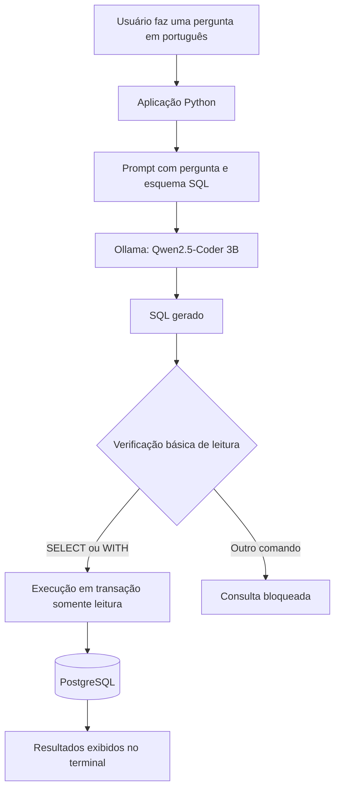
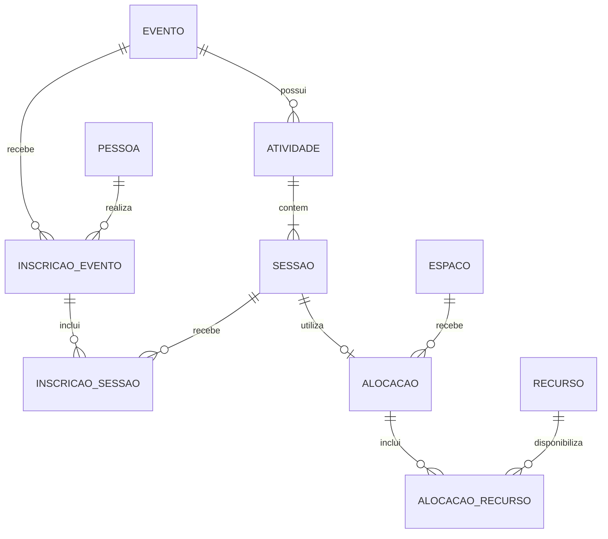

# Sistema de Gestão de Eventos e Espaços com IA

**Banco de dados relacional com PostgreSQL e consultas em linguagem natural utilizando um LLM local (Text-to-SQL).**

## Sobre o projeto

O projeto foi desenvolvido no contexto da disciplina **SCC0640 — Projeto de Bases de Dados**. Seu objetivo é modelar e implementar um sistema para gerenciar **eventos, atividades, sessões, participantes, espaços físicos e recursos**, conciliando regras de negócio e integridade dos dados.

Além da implementação relacional, foi criado um **protótipo em Python** que integra PostgreSQL e **Ollama**, permitindo fazer perguntas em português e obter consultas SQL geradas pelo modelo **`qwen2.5-coder:3b`**. As consultas geradas são exibidas ao usuário e executadas em uma transação configurada como somente leitura.

> **Diferencial:** a integração de IA permite consultar os dados em linguagem natural, sem exigir que o usuário escreva SQL manualmente. O modelo é executado localmente, sem dependência de uma API de LLM em nuvem.

## Principais funcionalidades

### Gestão de eventos e recursos

- Cadastro de eventos, edições de séries, atividades e múltiplas sessões por atividade.
- Representação de promotores como pessoas, empresas ou organizações.
- Associação de participantes e responsáveis a eventos e sessões, com diferentes papéis.
- Alocação de espaços e recursos necessários à realização das sessões.
- Validação de períodos, capacidades e conflitos de alocação.
- Inscrição em eventos e inscrição adicional em sessões com vagas limitadas.
- Controle de **fila de espera** e promoção de participantes quando surgem vagas.
- Uso de **constraints, funções, triggers e transações** para implementar regras de integridade.

### Consultas SQL e inteligência artificial

O protótipo disponibiliza duas formas de interação com o banco:

1. **Consultas predefinidas:** execução de cinco consultas SQL voltadas a problemas reais do domínio.
2. **Linguagem natural (Text-to-SQL):** uma pergunta em português é enviada ao modelo local, acompanhada de informações sobre o esquema do banco. O programa recebe o SQL, apresenta a consulta gerada e tenta executá-la no PostgreSQL.

As cinco consultas predefinidas abrangem:

| # | Consulta | Finalidade |
|---|---|---|
| 1 | Programação de um evento | Listar atividades, sessões, horários e espaços. |
| 2 | Pendências de recursos | Identificar recursos necessários ainda não totalmente alocados. |
| 3 | Participação em sessões restritas | Localizar pessoas inscritas em todas as sessões restritas elegíveis de um evento. |
| 4 | Fila de espera | Mostrar as primeiras pessoas de cada fila elegível. |
| 5 | Disponibilidade de espaços | Encontrar espaços autorizados que atendam à capacidade e ao intervalo de tempo informados. |

## Tecnologias utilizadas

| Tecnologia | Aplicação no projeto |
|---|---|
| **PostgreSQL 16+** | Banco de dados relacional, consultas, views, constraints, triggers e funções. |
| **SQL** | Definição do esquema, carga de dados e consultas. |
| **Python 3.11+** | Interface de linha de comando e integração entre os componentes. |
| **Psycopg 3** | Conexão e execução de consultas no PostgreSQL. |
| **Ollama** | Execução local do modelo de linguagem. |
| **Qwen2.5-Coder 3B** | Geração de consultas SQL a partir de perguntas em português. |
| **Mermaid / draw.io** | Documentação dos modelos de dados. |

## Arquitetura da solução de IA



**Como funciona:** o programa extrai as definições de tabelas e views do DDL disponível em `Projeto.txt` e as incorpora ao prompt. O modelo responde com uma consulta SQL, que é limpa e submetida a uma verificação básica antes da execução. O PostgreSQL também é configurado para tratar a transação da consulta gerada como **somente leitura**.

> **Importante:** o SQL gerado não é garantidamente correto. A aplicação apresenta a consulta e eventuais erros retornados pelo banco. A verificação inicial do texto não substitui uma análise completa de segurança.

## Modelagem e integridade de dados

A implementação contém **21 tabelas, 2 views, 11 funções e 7 triggers**. O modelo contempla relacionamentos entre eventos, atividades, sessões, participantes e infraestrutura.

Exemplo simplificado do domínio:



Entre as regras modeladas estão a especialização de agentes, a consistência de inscrições, a capacidade das sessões, a compatibilidade entre espaços e recursos e a prevenção de conflitos de agenda.

**Diagramas completos:**

- [Modelo Entidade-Relacionamento (PDF)](diagramas/ER.pdf)
- [Modelo Relacional (PDF)](diagramas/Relacional.pdf)
- [Modelo Relacional em Mermaid](diagramas/Relacional.mmd)
- [Fonte editável do MER (draw.io)](diagramas/MER.drawio)

## Estrutura do repositório

```text
.
├── Prototipo/
│   ├── main.py             # Interface CLI, consultas e integração com IA
│   └── requirements.txt    # Dependências Python
├── diagramas/
│   ├── ER.pdf              # Modelo Entidade-Relacionamento
│   ├── ER.xml              # Fonte do diagrama ER
│   ├── MER.drawio          # Modelo editável
│   ├── Relacional.mmd      # Diagrama Mermaid
│   └── Relacional.pdf      # Diagrama relacional
├── schema.sql              # DDL: tabelas, funções, triggers e views
├── DML.sql                 # Carga de dados fictícios e operações de exemplo
├── Projeto.txt             # Relatório, decisões de projeto e consultas SQL
├── Instrucoes.txt          # Instruções originais de execução
└── README.md
```

O arquivo local `Prototipo/config.json` é necessário para executar o protótipo, mas **não está versionado** por conter configurações de conexão.

## Como executar

### 1. Pré-requisitos

Instale:

- [PostgreSQL](https://www.postgresql.org/download/) **16 ou superior**, com acesso ao `psql`;
- [Python](https://www.python.org/downloads/) **3.11 ou superior**;
- [Ollama](https://ollama.com/download).

### 2. Obter o projeto

Clone o repositório no GitHub (ou baixe o ZIP) e abra um terminal **na pasta raiz**, onde estão `schema.sql` e `DML.sql`.

### 3. Criar e preparar o banco

Crie o banco chamado `eventos`:

```bash
createdb -U postgres eventos
```

Alternativamente, execute `CREATE DATABASE eventos;` no pgAdmin ou em uma sessão SQL conectada a outro banco.

Em seguida, **na raiz do repositório**, execute:

```bash
psql -U postgres -d eventos -v ON_ERROR_STOP=1 -f schema.sql
psql -U postgres -d eventos -v ON_ERROR_STOP=1 -f DML.sql
```

O `schema.sql` cria as estruturas do banco; o `DML.sql` realiza a carga inicial de dados fictícios e operações que exercitam regras de negócio. **Execute a carga apenas uma vez em um banco vazio.**

Para conferir a carga:

```sql
SELECT COUNT(*) FROM evento;
```

Com a carga prevista no projeto, o resultado esperado é **11 eventos**.

### 4. Configurar a conexão

Crie manualmente o arquivo **`Prototipo/config.json`** com o seguinte conteúdo, ajustando os dados do seu PostgreSQL:

```json
{
  "database": {
    "host": "localhost",
    "port": 5432,
    "dbname": "eventos",
    "user": "postgres",
    "password": "SUA_SENHA_AQUI"
  },
  "ollama": {
    "host": "http://localhost:11434",
    "model": "qwen2.5-coder:3b"
  }
}
```

**Segurança:** não publique senhas reais. O `config.json` já está listado no `.gitignore` do projeto.

### 5. Instalar as dependências Python

No terminal:

```bash
cd Prototipo
python -m pip install -r requirements.txt
```

Se desejar, crie e ative um ambiente virtual Python antes de instalar as dependências.

### 6. Preparar o modelo de IA

Baixe o modelo utilizado no projeto:

```bash
ollama pull qwen2.5-coder:3b
```

Garanta que o serviço Ollama esteja em execução. Em ambientes que não iniciam o serviço automaticamente, utilize `ollama serve` em outro terminal.

### 7. Executar o protótipo

Ainda na pasta `Prototipo`, rode:

```bash
python main.py
```

O menu oferece três opções:

```text
==============================
1. Executar uma das 5 consultas
2. Perguntar em linguagem natural
3. Sair
Opcao:
```

**Exemplo de pergunta na opção 2:**

> Quais são os eventos cadastrados e suas respectivas datas de início e término?

O programa exibe o **SQL gerado pelo modelo** e o resultado retornado pelo banco, ou uma mensagem de erro caso a consulta não seja válida.

## Limitações conhecidas

- A qualidade da geração de SQL depende do modelo local e da complexidade da pergunta; podem ocorrer erros de interpretação ou de sintaxe.
- A inferência pode ser lenta em computadores com recursos limitados, especialmente na primeira interação.
- O banco armazena a **programação corrente**, sem manter histórico de alterações.
- O protótipo oferece uma **interface de terminal**, não uma aplicação web.
- O fluxo Text-to-SQL implementa proteções básicas e deve ser reforçado antes de qualquer uso em produção.


